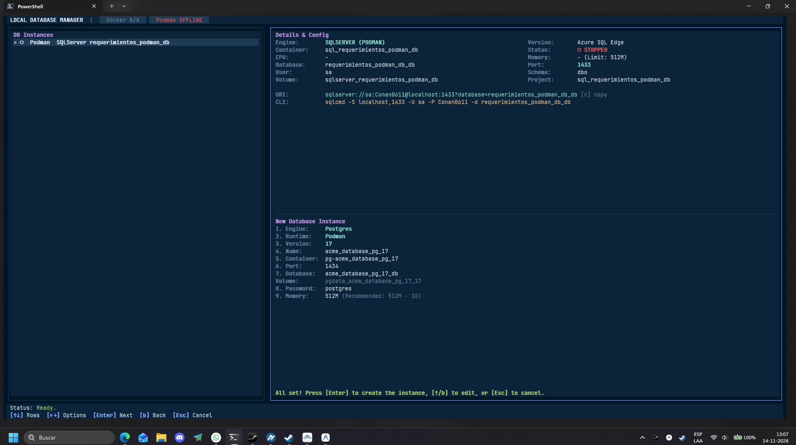
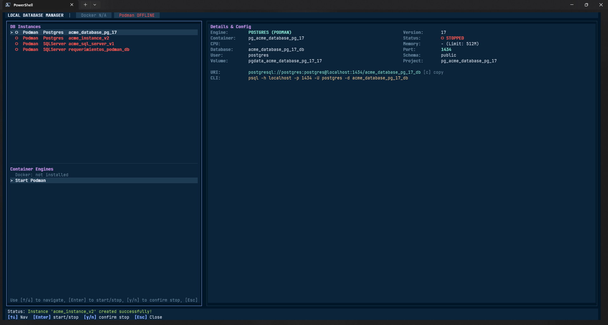
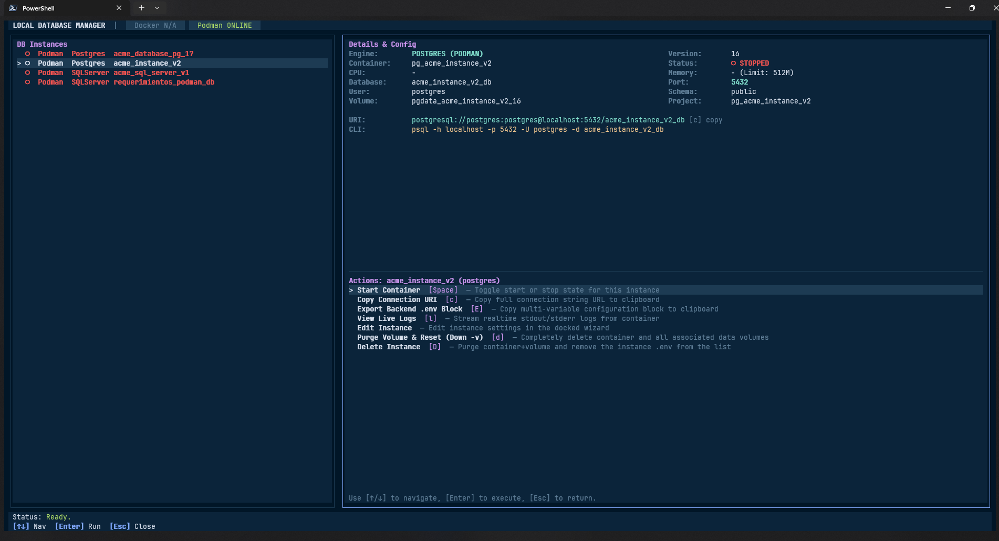
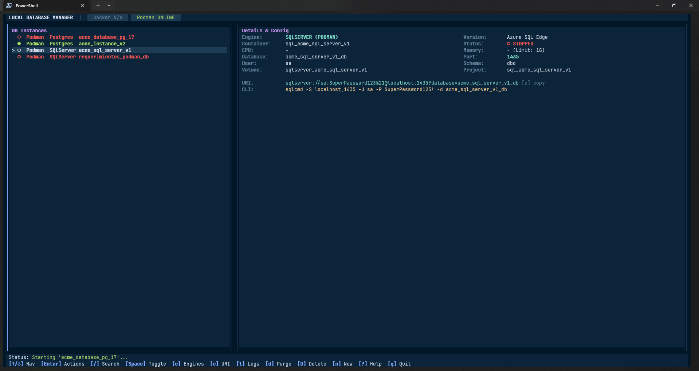

# Local Database Manager 🗄️

[](go.mod)
[](LICENSE)
[](https://github.com/Opsord/local-database-manager/releases)

Stop juggling ports and loose `docker-compose.yml` files for local **PostgreSQL** and **SQL Server** databases.  
A lightweight, high-performance interactive Terminal User Interface (TUI) and headless CLI built in **Go** with **Bubble Tea / Charm** for centralized lifecycle management across **Docker** and **Podman**.

---

## Screenshots

### 1. Interactive Create Instance Wizard (`n`)


### 2. Container Engines Panel (`e`)


### 3. Instance Actions Menu (`Enter`)


### 4. Active & Stopped Instances Overview


---

## Quick Install

### Option 1: `go install` (Recommended)
```bash
go install github.com/Opsord/local-database-manager/cmd/db-manager@latest
```
Run `db-manager` from any directory. On first launch, it automatically initializes `~/.db-manager` with default engine templates and `config.yml`.

### Option 2: Precompiled Binaries (CLI/TUI & Desktop App)
Download either the CLI/TUI archive (`db-manager_*`) or the native lightweight Wails Desktop app (`db-manager-desktop_*`) for Windows, macOS, or Linux from the [Releases](https://github.com/Opsord/local-database-manager/releases) page, extract it, and run `db-manager` or `db-manager-desktop`.

---

## Features

- ⚡ **Ultra-lightweight & Blazing Fast:** < 15 MB idle RAM footprint, 0% CPU in background.
- 📁 **Centralized Instances:** All declarative configurations live in `instances/*.env`.
- 🏷️ **Custom Container Naming:** Define clean container names (`CONTAINER_NAME`), preventing collisions or default directory prefixes.
- 🩺 **Runtime Daemon Health Monitoring:** Live status badges in the header (`🟢 Docker: ONLINE`, `🔴 Podman: OFFLINE`).
- 🩺 **Database Readiness Probe (Real Health Check):** Distinguishes between `🟢 READY (Accepting Connections)` and `🟡 STARTING (Engine Booting / Init...)` via live TCP socket probing.
- 📊 **Real-time CPU & Memory Monitoring:** Displays live container metrics (`CPU: 0.81%`, `RAM Usage: 124.5MiB / 15.6GiB`).
- 📋 **One-Key Connection Copy:** Copy standard connection URIs (`postgresql://...`, `sqlserver://...`) directly to the clipboard with `c`.
- 📦 **Backend .env Block Export (`E` / `x`):** Copy a complete multi-variable configuration block formatted ready to paste into backend projects.
- 🪄 **Interactive Creation Wizard (`n`):** Step-by-step form to spin up new database instances with automatic free port detection.
- 📦 **Postgres Version Selection:** Choose majors 14–18 in the create/edit wizard; volumes are auto-named (`pgdata_<name>_<version>`).
- ✏️ **In-TUI Edit Instance:** Docked wizard (via Action Menu) to edit instance fields; **Runtime is locked** after creation (create a new instance to switch Docker/Podman); `[o]` opens external editor; saving while running prompts restart (`y`/`n`).
- 📜 **Advanced Real-time Log Streamer (`l`):** Fullscreen logs viewport with live filtering (`/`), follow/pause toggle (`f`/`Space`), buffer copying (`c`), and smooth scrolling.
- 💻 **Headless CLI Mode:** Run commands directly in your terminal or scripts without launching the TUI (`dbm list`, `dbm up`, `dbm down`, `dbm restart`, `dbm uri`, `dbm env`, `dbm logs`).
- 🧹 **Safe Volume Purge (`d`):** Destroy container and associated data volumes with confirmation.
- 🗑️ **Delete Instance (`D`):** Purge container+volume and remove the instance `.env` from the list (engine must be online).
- 🐳 **Engines Panel (`e`):** Docked left panel to start Docker Desktop / Podman when offline, or stop when online (`y/n` confirm).

---

## Directory Structure

```text
local-database-manager/
├── engines/                         # Master compose definitions and init scripts
│   ├── postgres/
│   │   ├── docker-compose.yml       # Postgres Docker Compose template
│   │   ├── podman-compose.yml       # Postgres Podman Compose template
│   │   └── init/                    # Base initialization scripts (.sh)
│   └── sql-server/
│       ├── docker-compose.yml       # SQL Server Docker Compose template
│       ├── docker-entrypoint.sh     # Health check & init runner
│       └── init/                    # Base initialization scripts (.sql)
│
├── instances/                       # Declarative instance configurations
│   ├── *.env                        # Individual instance env files (git-ignored)
│   └── .env.template                # Reference configuration template (tracked in git)
│
├── cmd/
│   ├── db-manager/
│   │   └── main.go                  # CLI/TUI entrypoint and project root detection
│   └── db-manager-desktop/
│       └── main.go                  # Wails v2 Desktop GUI entrypoint
│
├── frontend/                        # Desktop UI (React + TypeScript + Tailwind via pnpm/Vite)
│
├── scripts/                         # Setup and automation helper scripts
│   ├── setup-alias.ps1              # Windows PowerShell shortcut setup script
│   └── setup-alias.sh               # Bash/Zsh shortcut setup script
│
├── internal/
│   ├── core/                        # Domain logic (instance model, parser, ports, runner)
│   ├── desktop/                     # Desktop service bridge and unit tests
│   └── app/                         # Bubble Tea UI presentation layer
│
├── config.yml                       # App settings (engine health poll interval)
├── go.mod
├── go.sum
├── AGENTS.md
└── README.md
```

## App config

`config.yml` at the project root sets app knobs. Today the only key is `engine_health_interval` (Go duration, e.g. `5s`). Restart the TUI after changing it. Missing or invalid config prevents startup.

---

## Keyboard Shortcuts

| Key | Action | Description |
| :--- | :--- | :--- |
| `↑` / `↓` or `k` / `j` | Navigate | Move cursor through configured database instances |
| `Enter` | Action Menu | Dock Action Menu in the bottom-right panel (Start/Stop, Copy URI, Logs, **Edit Instance**, Purge, Delete Instance) |
| `o` | External editor | While **Edit Instance** wizard is open, open the `.env` in your system editor |
| `/` | Live Search | Filter database instances in real-time by name, engine, runtime or port |
| `Space` | Start / Stop | Toggle container state (`up -d` / `down`) |
| `c` | Copy URI | Copy full connection URI (`postgresql://...`) to clipboard |
| `E` / `x` | Export .env | Copy complete backend `.env` block to clipboard |
| `l` | Live Logs | Open real-time log viewer (`Esc` / `q` to return) |
| `n` | New Instance | Open interactive instance creation wizard |
| `e` | Engines | Dock Engines panel (left) — Start when offline; Stop when online (`y/n` confirm) |
| `d` | Purge | Destroy container and volume only (`y/N`); keeps `.env` |
| `D` | Delete Instance | Purge + remove `.env` definition (`y/N`); requires online engine |
| `r` | Reload | Rescan `instances/` directory and refresh daemon health |
| `?` | Help | Open shortcuts cheatsheet and driver recommendations |
| `q` / `Ctrl+C` | Quit | Exit application |

### Logs Viewer Shortcuts (`l`)

| Key | Action | Description |
| :--- | :--- | :--- |
| `f` / `Space` | Toggle Follow | Toggle between `[● FOLLOWING]` (autoscroll) and `[⏸ PAUSED]` |
| `/` | Live Filter | Filter logs in real-time (`Enter` to keep, `Esc` to clear) |
| `c` / `y` | Copy Logs | Copy currently visible/filtered log lines to clipboard |
| `↑` / `↓` or `PgUp` / `PgDn` | Scroll | Navigate log lines manually (auto-pauses scroll) |
| `Esc` / `q` | Return | Return to main view (clears search first if active) |

---

## Headless CLI Commands

Manage instances directly without opening the interactive TUI:

```bash
dbm list                     # List all instances, ports, statuses, CPU% & RAM
dbm up <name>                # Start an instance (or dbm start)
dbm down <name>              # Stop an instance (or dbm stop)
dbm restart <name>           # Restart an instance
dbm uri <name> [-c|--copy]   # Print or copy connection URI
dbm env <name> [-c|--copy]   # Print or copy backend .env block
dbm logs <name>              # Stream container logs directly
dbm help                     # Show CLI command help
```

---

## Getting Started

### 1. Run in Development
```bash
go run ./cmd/db-manager
```

### 2. Build Executable Binary
```bash
go build -o db-manager.exe ./cmd/db-manager
```

### 3. Build Desktop App (`db-manager-desktop`)
```bash
pnpm --dir frontend install --frozen-lockfile
pnpm --dir frontend run build
go build -tags "desktop,production" -ldflags "-s -w -H windowsgui" -o db-manager-desktop.exe ./cmd/db-manager-desktop
```

- Uses native OS WebView (WebView2 on Windows, WebKit on macOS/Linux) with **Zed Dark** and **Night Owl** themes, Command Palette (`Ctrl+K`), live container logs, and 100% feature parity with the TUI.

---

## Terminal Shortcut Setup (`dbm`)

To run `dbm` from any folder across your terminal sessions:

### Option A: Automatic Setup (Recommended)

Run the included setup script. It automatically detects the repository location (wherever you cloned it), compiles the binary if missing, creates your shell profile directory safely if it doesn't exist, and avoids duplicate definitions if run again:

**PowerShell (Windows):**
```powershell
.\scripts\setup-alias.ps1
```
> [!TIP]
> - **Running from another location:** Pass `-RepoPath "path\to\local-database-manager"`.
> - **Targeting another profile:** Pass `-TargetProfile $PROFILE.CurrentUserAllHosts` (e.g. to share across Windows PowerShell and PowerShell 7) or specify an explicit `.ps1` file.
> - If PowerShell displays an execution policy error, run once: `Set-ExecutionPolicy RemoteSigned -Scope CurrentUser`.

**Bash / Zsh (Linux, macOS, Git Bash):**
```bash
chmod +x ./scripts/setup-alias.sh
./scripts/setup-alias.sh
```

---

### Option B: Manual Setup (PowerShell)

If you prefer to configure your PowerShell profile manually:

1. Compile the binary first (if not done yet):
```powershell
go build -o db-manager.exe ./cmd/db-manager
```

2. Open PowerShell and run:
```powershell
# Dynamically resolves the repo directory (or specify: $repoPath = "C:\path\to\local-database-manager")
$repoPath = (Get-Location).Path

$markerStart = "# >>> local-database-manager (dbm) >>>"
$markerEnd   = "# <<< local-database-manager (dbm) <<<"

$functionCode = @"
$markerStart
function dbm {
    Push-Location "$repoPath"
    try {
        .\db-manager.exe `$args
    } finally {
        Pop-Location
    }
}
$markerEnd
"@

# Ensure profile directory and file exist
$profileDir = Split-Path -Parent $PROFILE
if (!(Test-Path $profileDir)) { New-Item -ItemType Directory -Path $profileDir -Force | Out-Null }
if (!(Test-Path $PROFILE)) { New-Item -ItemType File -Path $PROFILE -Force | Out-Null }

# Idempotently update or append
$content = Get-Content -Path $PROFILE -Raw -ErrorAction SilentlyContinue
$pattern = "(?s)" + [regex]::Escape($markerStart) + ".*?" + [regex]::Escape($markerEnd)
if ($content -and ($content -match $pattern)) {
    $content = $content -replace $pattern, $functionCode
    Set-Content -Path $PROFILE -Value $content -NoNewline
} else {
    Add-Content -Path $PROFILE -Value "`r`n$functionCode"
}

. $PROFILE
```

3. Type `dbm` anywhere in your terminal:
```powershell
dbm
```

---

## License
MIT
